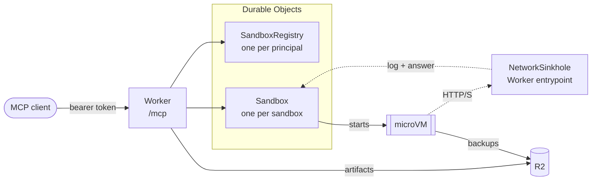

# mcp-container-sandbox

A remote MCP server on Cloudflare Workers that gives AI agents Linux sandboxes
on [Cloudflare Containers](https://developers.cloudflare.com/containers/). It
was built for malware analysis, where you want a machine you can throw away but
also come back to days later.

Each sandbox is an x86-64 Debian microVM with its own kernel. Sandboxes start
offline. Samples come in through the Worker (`file_fetch_url`, `file_write`,
`artifact_import`), so the sandbox itself never needs network access. When you
want to see what a sample does on the network, put the sandbox in sinkhole mode.
The Worker then answers every outbound HTTP and HTTPS request itself and logs
it. The answer is an empty `200` unless you've set rules. You see the C2
traffic, but nothing leaves Cloudflare.

## How it works



Each sandbox is a Durable Object that owns its container through the
[Durable Object Container API](https://developers.cloudflare.com/containers/api/durable-object-container/).
It uses the `durable_object` scheduling policy, which lets it pick the image,
instance size, network mode and snapshot every time it starts the container. A
second Durable Object per principal keeps the list of that principal's
sandboxes.

In sinkhole mode, the container's outbound HTTP and HTTPS go to
`NetworkSinkhole`, which asks the sandbox's Durable Object to log the request
and pick the answer. The log keeps the first 4 KiB of each request body; a
larger body, such as a stealer's upload, is also saved as an artifact under
`sinkhole/<name>/` (up to 64 MiB). These artifacts stay until you delete them,
like any other. R2 holds directory backups under
`backups/<principal>/<name>/` and artifacts under `artifacts/<principal>/`.

| File                   | Purpose                                                                                                             |
| ---------------------- | ------------------------------------------------------------------------------------------------------------------- |
| `src/index.ts`         | Worker entry: auth, `/mcp` routing, exports                                                                         |
| `src/mcp.ts`           | MCP tool definitions                                                                                                |
| `src/sandbox.ts`       | `Sandbox` Durable Object: container lifecycle, exec, files, jobs, persistence                                       |
| `src/registry.ts`      | `SandboxRegistry` Durable Object: lists a principal's sandboxes                                                     |
| `src/sinkhole.ts`      | `NetworkSinkhole`: answers and logs intercepted HTTP(S)                                                             |
| `src/links.ts`         | Signed, expiring artifact download and upload links (`/files/…`)                                                    |
| `src/auth.ts`          | Bearer token to principal                                                                                           |
| `src/output.ts`        | Head-and-tail capture of command output                                                                             |
| `src/db.ts`            | Schema and migrations for both Durable Objects, using [kysely-cloudflare](https://github.com/rc4/kysely-cloudflare) |
| `container/Dockerfile` | Analysis image                                                                                                      |

## Persistence

After 15 minutes with no calls and no running jobs, a sandbox saves itself and
stops, and the next call restores it without the agent having to do anything.
Files come back; processes don't. Several layers make that work, each lasting
longer than the one before:

| Layer                 | What survives                                           | How long                                    | Saved                                                                     |
| --------------------- | ------------------------------------------------------- | ------------------------------------------- | ------------------------------------------------------------------------- |
| Running instance      | Files, processes, background jobs                       | While in use, plus 15 idle minutes          | Always                                                                    |
| Container snapshot    | Whole root filesystem (not processes)                   | 30 days after creation or last restore      | Every 30 min while in use, on idle-stop, `sandbox_stop`, `sandbox_save`   |
| R2 directory backup   | `/workspace` (or any directory)                         | Until deleted; survives image upgrades      | On idle-stop and `sandbox_stop` (last 3 kept), `sandbox_save kind=backup` |
| R2 artifacts          | Individual files                                        | Until deleted; shared across your sandboxes | `artifact_export`                                                         |
| Durable Object SQLite | Config, job history, network log, snapshot/backup index | Until `sandbox_delete`                      | Always                                                                    |

If the latest snapshot has expired, the sandbox starts from the image and
restores the latest R2 backup of `/workspace`. That's why agents are told to
keep their work there.

## Tools

| Tool                                                                                                   | Purpose                                                                                                                             |
| ------------------------------------------------------------------------------------------------------ | ----------------------------------------------------------------------------------------------------------------------------------- |
| `sandbox_create`, `sandbox_list`, `sandbox_status`, `sandbox_update`, `sandbox_stop`, `sandbox_delete` | Lifecycle. `create` can clone another sandbox's filesystem. `status` includes the image version and tool versions.                  |
| `sandbox_exec`                                                                                         | Run a bash command (up to 30 min). Returns exit code, signal, timeout, and stdout and stderr with the middle cut out when long      |
| `sandbox_job_start`, `sandbox_job_status`, `sandbox_job_list`, `sandbox_job_kill`                      | Background jobs (up to 6 h) with log tailing                                                                                        |
| `file_write`, `file_read`, `file_list`                                                                 | File access (text or base64, byte ranges)                                                                                           |
| `file_fetch_url`                                                                                       | Download a URL via the Worker into the sandbox; returns SHA-256                                                                     |
| `artifact_export`, `artifact_import`, `artifact_list`, `artifact_delete`                               | Durable file storage in R2. Export zips directories (optionally encrypted, e.g. `infected`); import can extract zip/7z/tar/rar      |
| `artifact_download_url`, `artifact_upload_url`                                                         | Expiring signed links for moving large files directly between R2 and the agent or user                                              |
| `sandbox_save`, `sandbox_restore`                                                                      | Manual snapshots and R2 backups, and restoring them                                                                                 |
| `sandbox_sinkhole_rules`, `sandbox_network_log`                                                        | What sinkhole mode answers (status, headers, inline body or an artifact, matched by host/path/method), and the requests it captured |

## The image

The image is about 1.7 GB and includes:

| Area                    | Tools                                                                                                          |
| ----------------------- | -------------------------------------------------------------------------------------------------------------- |
| Search                  | ripgrep (`rg`), grep, find                                                                                     |
| Triage                  | `file`, Detect It Easy (`diec`), capa, FLOSS, YARA, ssdeep, ExifTool, binwalk, binutils, `xxd`, `osslsigncode` |
| Native code             | radare2, gdb, strace, ltrace, UPX, speakeasy (Windows PE/shellcode emulation)                                  |
| Java and Android        | JDK 21 (`java`, `javac`, `javap`), CFR, Vineflower, jadx, apktool                                              |
| Python payloads         | pyinstxtractor, pycdc/pycdas                                                                                   |
| Documents               | oletools, `oledump`, `pdfid`, `pdf-parser`, qpdf, poppler-utils                                                |
| Archives and installers | 7-Zip, zip/unzip, `unar`, cabextract, innoextract, msitools                                                    |
| Other                   | Node.js, tshark, tcpdump, sqlite3, jq                                                                          |
| Python libraries        | pefile, dnfile, pyelftools, LIEF, Capstone, yara-python, PyCryptodome, python-magic, pyzipper, xdis            |

Ghidra and a .NET decompiler didn't make it in because of size. Ghidra would
add about 1 GB, and the decompiler needs the whole .NET SDK. pycdc decompiles
bytecode up to about Python 3.11 and only disassembles newer versions.

`container/Dockerfile` pins every tool that Debian doesn't package by version
and SHA-256. The build writes every tool's version, plus
`IMAGE_VERSION`, to `/etc/sandbox-image.json`, which `sandbox_status` reports.
Bump `IMAGE_VERSION` whenever you change the Dockerfile.

Deploying a new image never restarts running sandboxes. Snapshots include the
image, so each sandbox keeps the one it has until an agent runs
`sandbox_update` with `upgrade_image`. The upgrade carries `/workspace` over
through an R2 backup and keeps the old state as a snapshot. Until then, command
results remind the agent about the upgrade, at most once an hour.

## Setup

You need a Workers Paid plan (for Containers) and Docker to build the image.

```sh
pnpm install
npx wrangler r2 bucket create mcp-container-sandbox
# Comma-separated principal:token pairs; each principal gets its own sandboxes.
npx wrangler secret put MCP_TOKENS        # e.g. alice:<openssl rand -hex 32>
npx wrangler secret put LINK_SIGNING_KEY  # openssl rand -hex 32; signs artifact links
pnpm run deploy
```

Clients connect to `https://<worker>.<subdomain>.workers.dev/mcp` with an
`Authorization: Bearer <token>` header, where `<token>` is the part after the
colon in `MCP_TOKENS`. For Claude Code:

```sh
claude mcp add --transport http sandbox https://<worker>.<subdomain>.workers.dev/mcp \
  --header "Authorization: Bearer <token>"
```

If you serve it from a custom domain, add the hostname to `ALLOWED_HOSTNAMES`
in `wrangler.jsonc`.

## Events and skills

The authenticated `/mcp` endpoint supports MCP 2.0 (`2026-07-28`) discovery
alongside existing MCP clients. It exposes
[`sandbox.job.finished`](https://developers.openai.com/plugins/build/mcp-events)
for background jobs that exit, are killed, or are lost after a container
restart.
Subscriptions require a sandbox `name` and optionally a `job_id`. For example,
ask ChatGPT to monitor a scan job and analyze its output when it finishes.
Events contain job metadata; retrieve the output with `sandbox_job_status`.
Commands and logs are excluded from webhook payloads.

The per-principal registry stores subscriptions and pending deliveries durably.
An alarm checks subscribed jobs every 30 seconds, without starting stopped
containers. Delivery starts at subscription time and has no protocol replay
(`cursor: null`). Subscriptions default to 24 hours and are capped at seven
days; `ttlMs` can request a shorter lifetime. A request for no expiration
receives the default finite lifetime. Refresh and unsubscribe use the event,
filters, and callback URL as their identity. Deleting a sandbox removes its
subscriptions, and removing a principal from `MCP_TOKENS` stops delivery.

Callbacks must use HTTPS on port 443. The Worker sends them with `fetch()`,
which reaches only the public Internet; requests to the Worker's own zone go
through Cloudflare like any other client's. Signing keys never reach a sandbox.
The sender verifies a signed challenge before activation, caches verification
for one hour, and signs deliveries using Standard Webhooks. Secret rotation
signs with both keys for five minutes. Requests time out after ten seconds and
callback responses are limited to 16 KiB. Transient failures get up to five
attempts with exponential backoff
starting at 30 seconds. Retries preserve the event ID. Redirects are never
followed; `410` removes the subscription, and `413` discards the event.

Two bundled skills cover sample triage and sinkhole analysis. They are exposed
through the
[MCP skill import extension](https://developers.openai.com/plugins/build/mcp-server#import-skills-from-the-mcp-server):
`skills/list`, `skills/get`, and `resources/read` provide the complete files and
SHA-256 digests. The files also live under `skills/` for local use. After
deploying changes, rescan the MCP server in the plugin portal to update imported
skills and event definitions. Test a subscription in ChatGPT, trigger a matching
job,
confirm delivery, and then stop monitoring to verify unsubscribe.

## Development

```sh
cp .dev.vars.example .dev.vars
pnpm dev         # wrangler dev; builds the image and runs containers in local Docker
pnpm test        # vitest in the Workers runtime (no containers needed)
pnpm lint && pnpm format
```

Local containers support snapshots too. Sinkhole mode and R2 directory backups
both depend on intercepting outbound traffic, which works locally through a
`cloudflare/proxy-everything` sidecar. The sidecar forwards to a listener that
workerd binds on the Docker bridge gateway, or on `127.0.0.1` when it can't.

### Podman

Wrangler shells out to `docker`, and two of its calls don't work with Podman.
The build runs `docker build --provenance=false -f - …`, which uses a flag
Podman doesn't know and reads the Dockerfile from stdin. The push is worse:
Podman recompresses the layers, so the pushed digest no longer matches the one
wrangler reports to Cloudflare, and Cloudflare can't find the image.
`scripts/podman-docker` fixes up the build and pushes with
`skopeo copy --preserve-digests` instead, so you'll need `skopeo` installed.
`pnpm run deploy` (`scripts/deploy`) detects Podman, including the `docker`
shim that Podman installs, and points wrangler at that script for you. Set
`WRANGLER_DOCKER_BIN` yourself to override the detection.

That's all `deploy` needs. `pnpm dev` is harder, because it also talks to the
Docker API socket, which Podman provides through `podman system service`.
Wrangler sends a `MemorySwappiness` setting that Podman rejects on cgroup v2,
so you need a small proxy in front of the socket that strips it. Even then,
rootless Podman can't run sinkhole mode or R2 backups locally. workerd can't
bind the gateway address there and falls back to `127.0.0.1`, which the sidecar
can't reach. To try those features, use Docker or deploy.

## Security

Each sandbox is its own microVM, so one sandbox can't see into another. Each
principal can only reach the sandboxes and artifacts under its own prefix.
Inside a sandbox, though, nothing is separated. Every command effectively runs
as root, whatever `user` you pass, because
[the platform doesn't enforce it](https://developers.cloudflare.com/sandbox/concepts/security/).
So a sample can read every file and every process in the sandbox it runs in,
and you shouldn't put credentials there. Headers you pass to `file_fetch_url`,
such as an API
key, stay in the Worker and never reach the sandbox.

`sinkhole` mode lets a sample believe it's online while nothing leaves
Cloudflare. `internet` mode lets it reach real servers, which you need for the
actual C2 reply or the next stage. The sample can then also tell its operator
it's running, download whatever it likes, and attack other hosts, all from
Cloudflare's network under your account. Switching modes restarts the sandbox
from a snapshot, so you can do the static work offline and go online only for
as long as you need.

`file_fetch_url` downloads from the Worker, so the server it fetches from sees
a Cloudflare address, not the sandbox.

Artifact links work for anyone who has the URL until they expire, which is
after an hour by default. The Worker serves downloads as attachments with
`nosniff` and a sandboxing CSP, so a browser saves a sample instead of rendering
it. Your zone's plan caps uploads through the Worker, at 100 MB on Free and
Pro.

Anything a sandbox returns, whether command output, file contents or the
network log, may have been written by the sample. Malware can contain text
aimed at the agent reading it, so agents should treat it as data, never as
instructions.

For a deployment with many users, replace the bearer tokens by putting
[Cloudflare Access](https://developers.cloudflare.com/cloudflare-one/access-controls/ai-controls/secure-mcp-servers/)
or OAuth in front of the endpoint and deriving the principal from the verified
identity.
